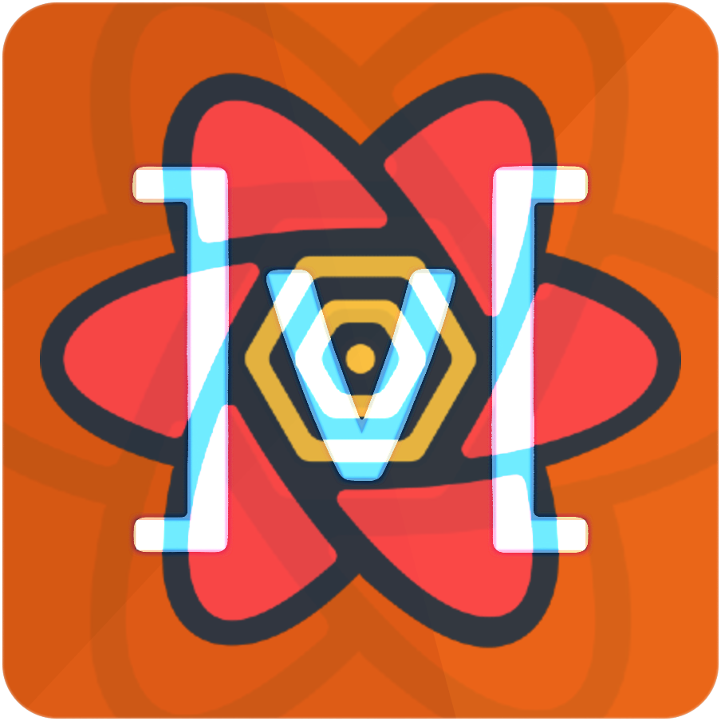

# mobx-tanstack-query

[![npm version][npm-image]][npm-url]
[![Build and test status][ci-image]][ci-url]
[![Monthly npm downloads][download-image]][npm-url]
[![View bundle size on Bundlephobia][size-image]][size-url]

[npm-image]: https://img.shields.io/npm/v/mobx-tanstack-query
[npm-url]: https://www.npmjs.com/package/mobx-tanstack-query
[ci-image]: https://img.shields.io/github/actions/workflow/status/js2me/mobx-tanstack-query/main.yml?label=build%20%26%20test
[ci-url]: https://github.com/js2me/mobx-tanstack-query/actions/workflows/main.yml
[download-image]: https://img.shields.io/npm/dm/mobx-tanstack-query
[size-image]: https://img.shields.io/badge/bundle%20size-Bundlephobia-blue
[size-url]: https://bundlephobia.com/package/mobx-tanstack-query



Use [TanStack Query Core](https://tanstack.com/query/latest) in your MobX stores. Queries and mutations expose observable state, so MobX reactions can respond when data arrives or a request fails.

[Read the documentation →](https://js2me.github.io/mobx-tanstack-query/)

## Quick example

```ts
import { autorun } from "mobx";
import { Query, QueryClient } from "mobx-tanstack-query";

const queryClient = new QueryClient();
const query = new Query({
  queryClient,
  queryKey: ["greeting"],
  queryFn: async () => {
    const response = await fetch("/api/greeting");
    if (!response.ok) throw new Error(response.statusText);
    return response.text();
  },
});

autorun(() => {
  if (query.isSuccess) console.log(query.data);
});
```

## Contributing

See the [contribution guide](./CONTRIBUTING.md) to get started.
